

  

<h1 align="center">Star Client</h1>

  A launcher and client mod for <b>Minecraft: Java Edition</b> on Windows – in blue and white. 
  <i>Not an official Minecraft product. Not approved by or associated with Mojang or Microsoft.</i>

  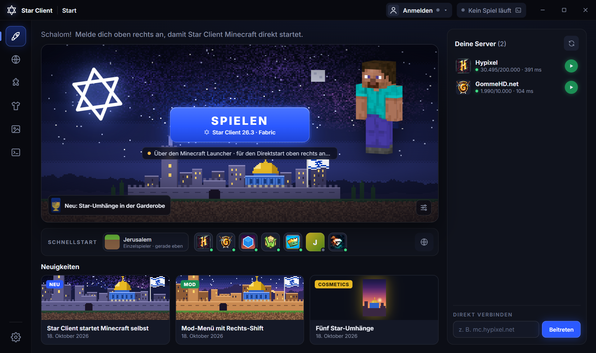

Star Client consists of two parts:

- **Star Client Launcher** – a desktop app for Windows that installs and starts Minecraft: Java Edition 26.3 with the
  Fabric loader, Star Client's own mod and a few well-known performance mods.
- **Star Client Mod** – a client-side Fabric mod with a settings menu, a movable HUD, quality-of-life features and
  cosmetic capes.

The user interface is in German.

> **Status:** Star Client is in active development and there is no public download yet.
> Signing in with a Microsoft account inside Star Client is waiting for approval by Mojang. Until then, Star Client
> prepares everything and starts the game through the official Minecraft Launcher.

## Launcher

| | |
|---|---|
| 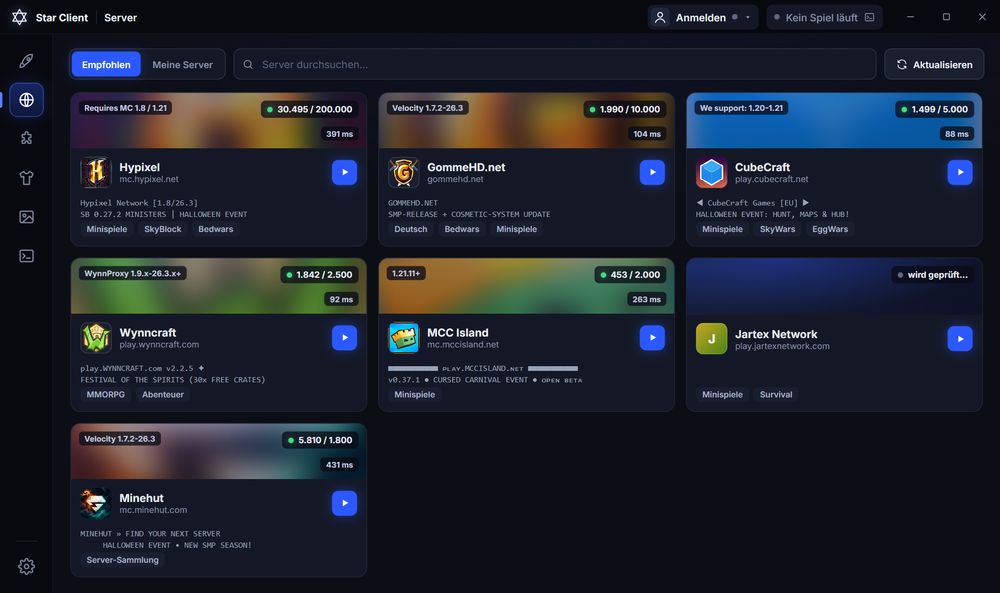 | 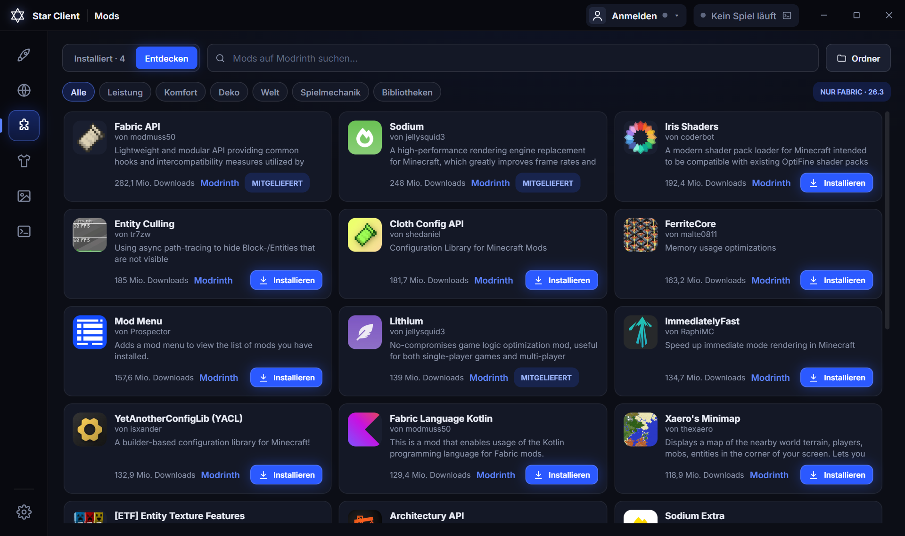 |
| 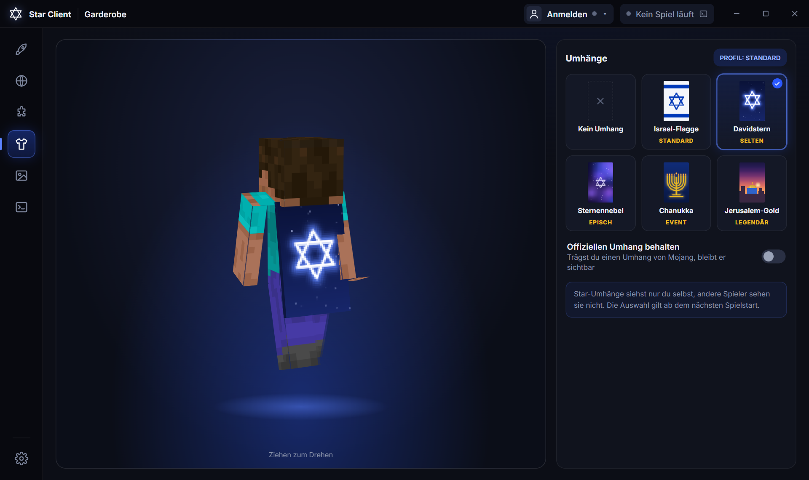 | 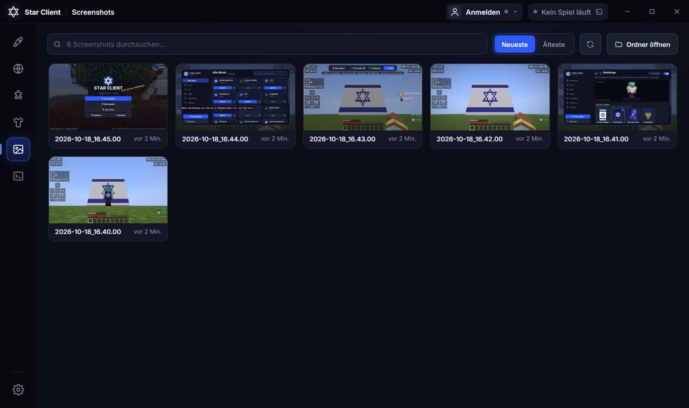 |

- **Play** – downloads Java 25 from Mojang, the game libraries and assets, the Fabric loader and the mods, with a real
  progress bar. Files that already exist in the official `.minecraft` folder are reused.
- **Quick play** – continue your last world or join a featured server with one click. Featured servers and your own
  multiplayer list show live player counts via the Minecraft server list ping.
- **Mods** – switch mods on and off, add your own `.jar` files by drag and drop, or search and install Fabric mods for
  Minecraft 26.3 from [Modrinth](https://modrinth.com) (required dependencies included, every file checked by SHA-1).
- **Wardrobe** – a 3D preview of your skin; choose one of five Star capes.
- **Screenshots, console and crash reports** – a gallery of your screenshots, the live game log and a short explanation
  when the game crashes.
- **Settings** – memory, JVM arguments, window size and what the launcher does while you play.

## Mod

  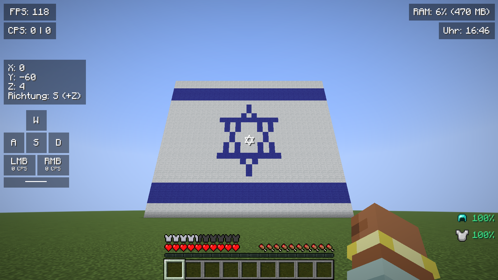

| | |
|---|---|
| 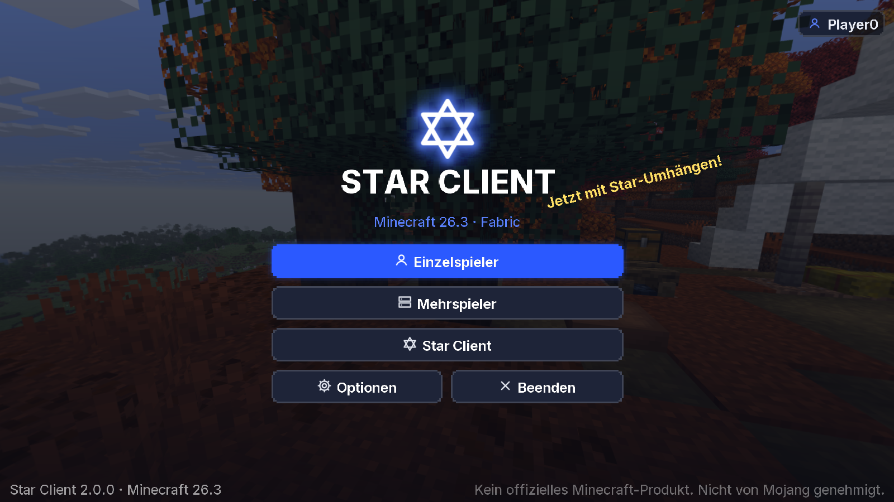 | 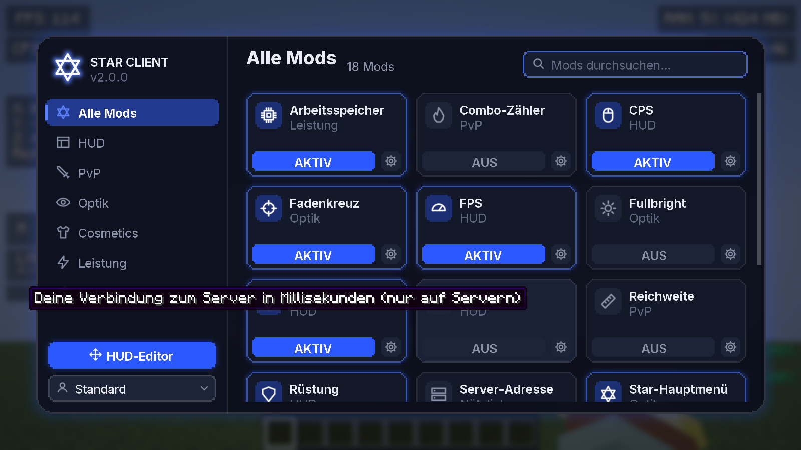 |
| 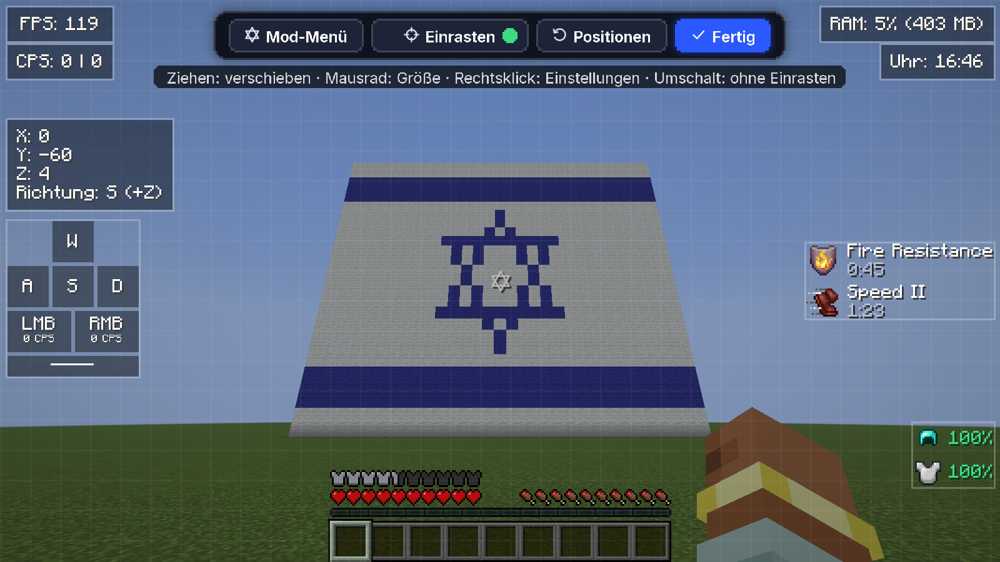 | 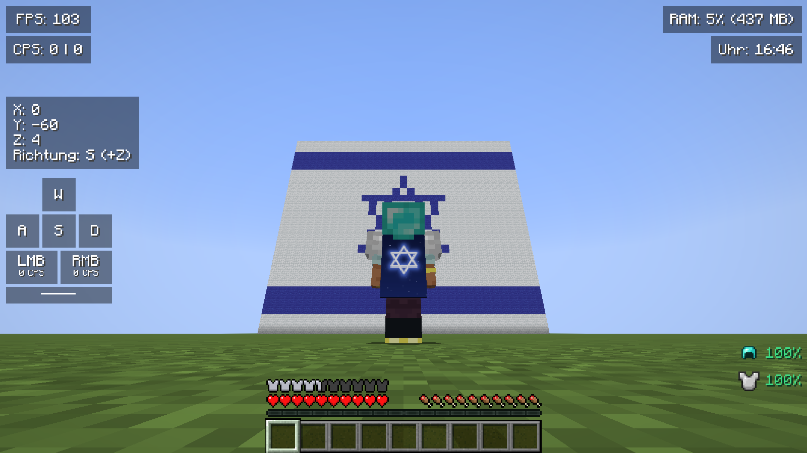 |

- **Mod menu** (Right Shift) with search, categories and settings for every module; several settings profiles with
  export and import.
- **HUD editor** – drag, snap and resize every display.
- **HUD displays** – FPS, CPS, ping, coordinates with direction, keystrokes, armor, potion effects, memory, clock,
  server address, combo counter and reach display.
- **More** – zoom, fullbright, a custom crosshair (including a Star of David), toggle sprint and the Star Client main menu.
- **Capes** – Israel flag, Star of David, nebula, Hanukkah and Jerusalem gold. Capes are only visible to you;
  other players do not see them.

**Fair play:** Star Client contains no cheats. Displays such as reach and combo only show information and do not
change how the game plays.

## Sign-in and privacy

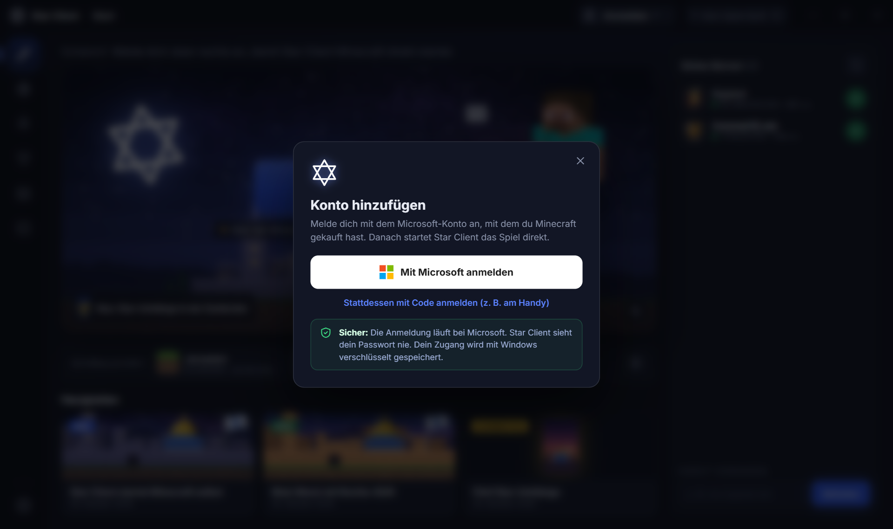

- Sign-in uses only the official Microsoft identity platform: the authorization code flow with PKCE in your normal web
  browser, or the device code flow on [microsoft.com/link](https://www.microsoft.com/link). Star Client never asks for
  your password and never sees it.
- The Microsoft token is exchanged via Xbox Live and XSTS for a Minecraft access token. Star Client reads your
  Minecraft profile to check that the account owns Minecraft: Java Edition. There is no offline or cracked mode.
- Tokens are stored only on your PC, encrypted with Windows (DPAPI), and are only sent to Microsoft and Mojang services.
- Star Client has no own servers and does not collect any data. It talks to Mojang and Microsoft (game files, sign-in,
  skins), [Fabric](https://fabricmc.net), [Modrinth](https://modrinth.com) (mods) and the Minecraft servers whose
  status you look at.

## Requirements

- Windows (64-bit)
- Minecraft: Java Edition (bought with your Microsoft account)

## Credits

- [Fabric](https://fabricmc.net) – mod loader and Fabric API
- [Sodium](https://modrinth.com/mod/sodium) and [Lithium](https://modrinth.com/mod/lithium) – performance mods,
  downloaded from Modrinth
- [Inter](https://rsms.me/inter/) – font, SIL Open Font License 1.1

Minecraft is a trademark of Mojang AB. Star Client is not affiliated with Mojang AB or Microsoft.

---

## Auf Deutsch

Star Client ist ein Launcher und eine Fabric-Mod für Minecraft: Java Edition 26.3 unter Windows, in Blau und Weiß.
Der Launcher lädt Java, das Spiel, Fabric und die Mods selbst, zeigt Server mit Live-Spielerzahlen, sucht Mods auf
Modrinth und hat eine Garderobe mit 3D-Vorschau. Die Mod bringt ein Mod-Menü (Rechts-Shift), einen HUD-Editor,
zwölf HUD-Anzeigen, Zoom, Fullbright, ein eigenes Fadenkreuz und fünf Star-Umhänge, die nur du selbst siehst.
Keine Cheats.

Die Anmeldung läuft ausschließlich über Microsoft; Star Client sieht dein Passwort nie. Solange Mojang die Anmeldung
für Star Client noch nicht freigegeben hat, startet das Spiel über den offiziellen Minecraft Launcher.
Star Client ist kein offizielles Minecraft-Produkt und nicht von Mojang oder Microsoft genehmigt oder mit ihnen
verbunden.
